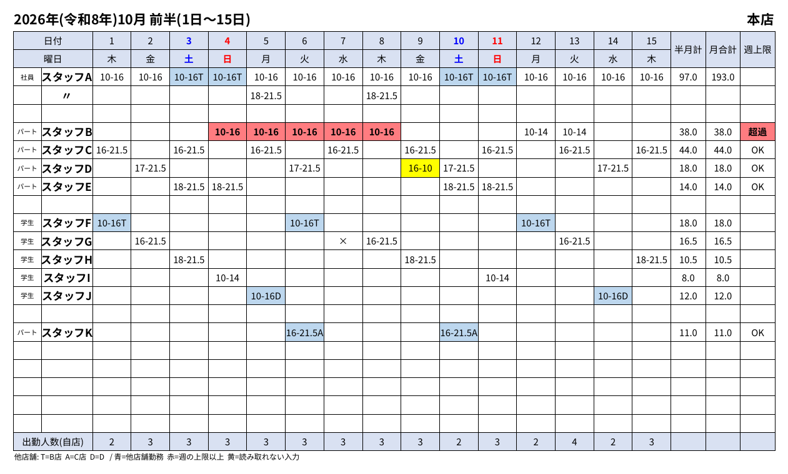
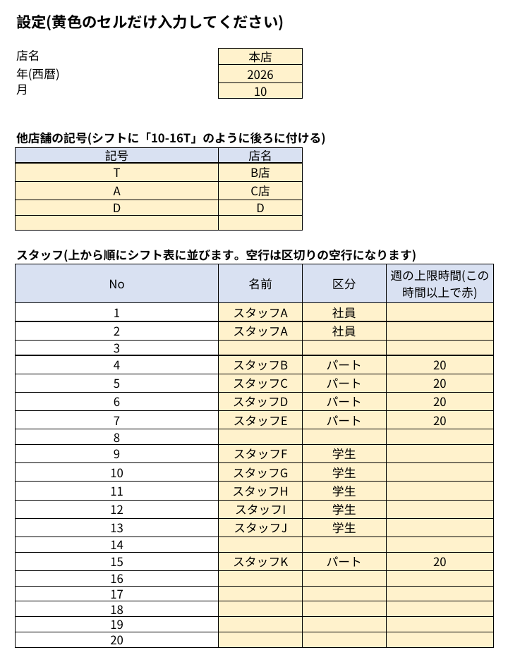

# シフト管理Excel（マクロなし）

アルバイト先の飲食店で紙で管理していたシフト表を、パソコンに不慣れな人でも使えるExcelファイルに作り替えたものです。完成後、現在も店舗で使われています。

> 公開用に、店舗名・スタッフ名はすべて仮の名前に置き換えています。

## 背景

紙のシフト表は、パートの週20時間の上限など確認する点が多く、作成とチェックに手間がかかっていました。一方で、シフトを作る人はパソコンにあまり慣れていません。

## 制約

- 無料版のExcelを使うため、マクロは使えない（数式と書式だけで作る）
- 追加費用はかけない
- パソコンに不慣れな人でも迷わず使えること
- 他の店舗でもそのまま使えること

## 主な機能

### 入力を楽にする
- シフトはマスをクリックしてプルダウンから選ぶだけ。よく使うシフトは「設定」シートで追加できる
- リストにない時間は `10-16` や `21.5`（21時半）のように直接打てる。全角で打っても読み取れる
- 1日に2回入る人は、設定で同じ名前を2行続けて書くと2段で入力でき、合計は1人分にまとまる
- 他店舗に入る日は `10-16T` のように記号を付けるだけで区別できる

### ミスを自動で知らせる
- 週（日曜〜土曜）の合計が上限以上になると、セルが赤くなり「超過」と表示される
- 月の1日が週の途中から始まる場合も、前月分の時間を足して週の上限を判定する
- 読み取れない入力（`16-10` など）は黄色で知らせる
- 他店舗勤務は青で表示し、週の上限には含め、自店の出勤人数からは除く

### 自動で出るもの
- 日付と曜日（土日は色分け）
- 半月計、月合計、日ごとの出勤人数

### 運用しやすくする
- 「前半（1〜15日）」と「後半（16日〜月末）」に分け、それぞれA4横1枚で印刷できる
- 毎月の作業は「月を選ぶ」「シフト欄を消す」だけ
- 書き換えるのは「設定」シートの黄色いセルだけ。店名、スタッフ、週の上限を変えれば他店舗でも使える
- 数式の入ったセルはシート保護で誤って消せないようにした
- 「使い方」シートに手順と色の意味をまとめた

## シート構成

| シート | 役割 |
|---|---|
| 使い方 | 毎月の手順、入力方法、色の意味 |
| 設定 | 店名、年月、スタッフ、週の上限、よく使うシフト、他店舗の記号 |
| 前半 / 後半 | シフトの入力と確認、印刷 |
| 計算（非表示） | 入力の読み取りと時間計算 |

## 使用技術

- Excel（数式、入力規則によるプルダウン、条件付き書式、シート保護）

## スクリーンショット

<!-- 画像を images/ フォルダに入れて、下のファイル名を合わせてください -->

### シフト入力画面（前半）

### 設定シート

